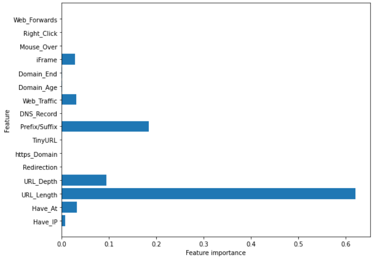

# Phishing Website Detection using Machine Learning

A machine learning project that classifies websites as legitimate or phishing from URL-based features, with a Flask web application (PhishGuard) for scanning URLs.

## Overview

This project has two parts:

1. **Model development** — a Jupyter notebook (`project.ipynb`) that loads a URL dataset, trains and compares several classifiers, and shows which features matter most.
2. **Web application** — a Flask app where a registered user can submit a URL, see a risk score with phishing indicators, and review their scan history. Scan data is stored in a MySQL database.

It was built as an academic project (February 2025) using an iterative development approach: requirement analysis, data collection and cleaning, feature extraction, model training, testing and evaluation, with repeated refinement.

## Problem Statement

Phishing websites imitate trusted sites to steal personal and financial information. Users often cannot tell a phishing URL from a real one at a glance. This project explores whether features of a URL and its website behavior can be used to classify a site as legitimate or phishing.

## Key Features

- Compares four classifiers on the same dataset: Decision Tree, Random Forest, Multilayer Perceptron and XGBoost.
- Extracts URL-based features such as URL length, special characters, sub-domains, IP address in the URL and HTTPS.
- Flask web interface with user registration, login and logout. Passwords are stored as salted hashes.
- URL scan page that returns a risk score and a list of phishing indicators.
- Dashboard, scan history and scan detail pages backed by a MySQL database.
- Education and About pages describing common phishing types.

## Technologies and Tools

| Category | Used |
| --- | --- |
| Language | Python |
| Machine learning | scikit-learn, XGBoost, pandas, NumPy |
| Visualization | matplotlib, seaborn |
| Web | Flask, HTML templates, CSS, JavaScript |
| Database | MySQL (`mysql-connector-python`) |
| URL and page analysis | tldextract, python-whois, requests, BeautifulSoup |
| Tools | Jupyter Notebook, Visual Studio Code |

## Workflow

1. Load the URL dataset (`dataset/urldata.csv`).
2. Split the data into training and test sets.
3. Train Decision Tree, Random Forest, Multilayer Perceptron and XGBoost models.
4. Compare accuracy on the test set and inspect feature importance.
5. Use the prediction module in the web app to score URLs submitted by users.
6. Save each scan and its features to MySQL for the dashboard and history pages.

## Folder Structure

```text
phishing-website-detection-ml/
├── app.py                       # Flask web application
├── config.example.py            # Example settings (copy to config.py)
├── database.py                  # MySQL connection, users and scan queries
├── enhanced_predictor_fixed.py  # URL feature extraction and prediction used by the app
├── enhanced_model.pkl           # Saved model loaded by the app
├── enhanced_scaler.pkl          # Saved scaler loaded by the app
├── phishing_patterns.pkl        # Saved phishing patterns loaded by the app
├── train_phishing_model.py      # Trains and evaluates an XGBoost model
├── project.ipynb                # Notebook: model comparison and feature importance
├── requirements.txt
├── dataset/                     # CSV datasets
├── static/                      # CSS, JavaScript and images
└── templates/                   # HTML pages
```

## Installation

1. Clone the repository and install the dependencies:

   ```bash
   git clone https://github.com/charujithjs/phishing-website-detection-ml.git
   cd phishing-website-detection-ml
   pip install -r requirements.txt
   ```

2. Create an empty MySQL database. The app creates the tables on first run.

   ```sql
   CREATE DATABASE phishingdetection;
   ```

3. Copy `config.example.py` to `config.py` and enter your own MySQL username and password. Also replace the secret key with a long random value (the comments in the file show how to generate one). `config.py` is listed in `.gitignore` and must never be uploaded.

## How to Run

Start the web app:

```bash
python app.py
```

Then open http://127.0.0.1:5000 in your browser, register an account and use the scan page.

**Optional admin account:** no accounts are created by default. To create an admin on first run, set these environment variables before starting the app (Windows PowerShell shown):

```powershell
$env:ADMIN_USERNAME = "your_admin_name"
$env:ADMIN_PASSWORD = "a_strong_password"
python app.py
```

`ADMIN_EMAIL` and `ADMIN_NAME` can also be set.

To explore the models, open `project.ipynb` in Jupyter Notebook or Google Colab. To train the XGBoost model from the script, run `python train_phishing_model.py`.

## Screenshots

<!-- Add your own screenshots after taking them from the running app, for example:

Upload them to an "images" folder in this repository. -->

### Feature importance



The chart shows how much each URL feature contributed in the notebook model. `URL_Length` has the highest importance, followed by `Prefix/Suffix` and `URL_Depth`.

## Dataset

- **File:** `dataset/urldata.csv`
- **Size:** 10,000 rows and 18 columns: a domain column, 16 URL and website features, and a label.
- **Features include:** `Have_IP`, `Have_At`, `URL_Length`, `URL_Depth`, `Redirection`, `https_Domain`, `TinyURL`, `Prefix/Suffix`, `DNS_Record`, `Web_Traffic`, `Domain_Age`, `Domain_End`, `iFrame`, `Mouse_Over`, `Right_Click` and `Web_Forwards`.

<!-- TODO: add the dataset name, source and link here, for example:
- **Source:** [Dataset name](link)
-->

The `dataset/` folder also contains other CSV files of phishing and legitimate URLs used by the web app.

## Methodology

The notebook splits the data into training and test sets, trains four classifiers, and measures accuracy on both sets. The XGBoost model was trained with a learning rate of 0.4 and a maximum depth of 7. `train_phishing_model.py` trains an XGBoost model and reports accuracy, precision, recall, F1 score and a confusion matrix.

## Results

Test-set accuracy as printed in `project.ipynb`:

| Model | Test accuracy |
| --- | --- |
| Decision Tree | 0.811 |
| Random Forest | 0.815 |
| Multilayer Perceptron | 0.854 |
| XGBoost | 0.861 |

XGBoost gave the highest test accuracy of the four models in this notebook. These figures come from one run on this dataset, so they should not be read as performance on real-world traffic.

## Known Limitations and Possible Improvements

- Database credentials and the secret key are read from `config.py`. Loading them from environment variables would be more flexible.
- The notebook reports accuracy only. Adding precision, recall and a confusion matrix would give a fuller picture.
- There are no automated tests for the prediction module yet.
- The app runs in Flask debug mode, which is meant for local development only.

## Author

**Charujith J S**
[LinkedIn](https://linkedin.com/in/charujith-js) · [Email](mailto:jscharujith@gmail.com)
